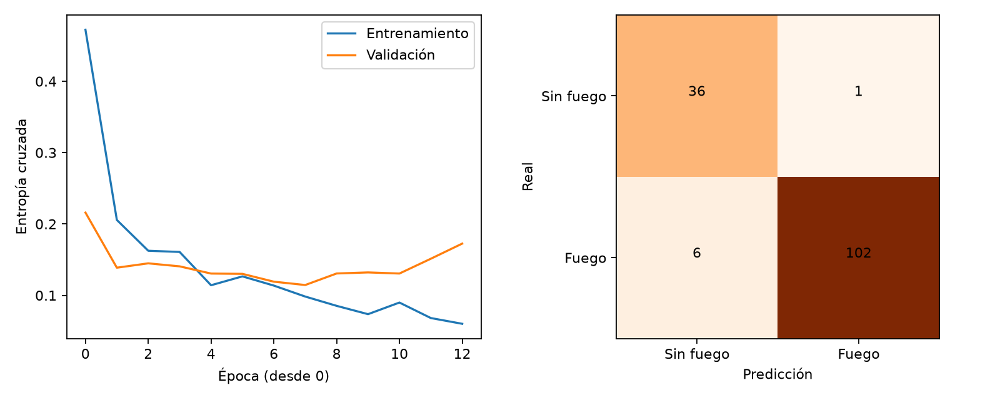

# Clasificación de imágenes de fuego mediante una CNN en Android

Bosque Alerta

Proyecto final de Aprendizaje Profundo
Universidad: [Completar]
IX semestre

Integrantes
1. [Nombre y apellidos]
2. [Nombre y apellidos]
3. [Nombre y apellidos]

Docente: [Completar]
Fecha de presentación: [Completar]

## Resumen

Se desarrolló un prototipo Android que clasifica fotografías en fuego y sin fuego mediante una red neuronal convolucional entrenada desde cero. Se utilizó FIRE Dataset de Ahmed Saied, con 999 imágenes originales. Tras la auditoría quedaron 961 imágenes únicas válidas. La evaluación reservada obtuvo una exactitud de 95.17% y un recall de fuego de 94.44%. El modelo se convirtió a TensorFlow Lite para inferencia local. Estos resultados describen la partición del dataset utilizada y no demuestran rendimiento operativo en incendios forestales de Puno.

## 1 Planteamiento del problema

La revisión visual de fotografías puede apoyar la identificación inicial de señales de fuego. El proyecto estudia si una CNN pequeña permite clasificar una fotografía y ejecutar esa clasificación en un teléfono sin conexión. Su aplicación propuesta son escenas de posibles incendios forestales; las etiquetas disponibles solamente distinguen presencia y ausencia de fuego. Por ello no se afirma que el sistema determine el tipo de incendio, su ubicación o su gravedad.

## 2 Objetivos

El objetivo general es implementar y evaluar una aplicación Android de clasificación binaria de imágenes mediante una CNN. Los objetivos específicos son organizar y auditar el dataset, construir particiones reproducibles, entrenar una arquitectura convolucional, medir su desempeño en prueba, exportarla a TensorFlow Lite y empaquetarla en un APK.

## 3 Fundamento del método

Una convolución aplica filtros aprendidos sobre regiones locales de la imagen. La activación ReLU introduce no linealidad y el pooling reduce la resolución espacial. Las capas densas combinan las características para generar una salida sigmoide entre cero y uno. Se optimiza la entropía cruzada binaria con Adam. La salida se interpreta como puntaje de fuego: un valor mayor o igual a 0.5 produce la clase fuego. No se realizó calibración probabilística.

## 4 Datos y procedencia

FIRE Dataset fue publicado por Ahmed Saied en Kaggle con la referencia phylake1337/fire-dataset, versión 1. La ficha declara licencia CC0. La descarga se conserva en dataset/fire-dataset-v1.zip y procedencia.json registra la URL y SHA-256 del archivo. Se encontraron 755 imágenes con fuego y 244 sin fuego. La unidad de clasificación es una imagen completa; no se dispone de cajas delimitadoras ni máscaras.

La auditoría verificó decodificación, convirtió imágenes a RGB y comparó hashes de píxeles y dimensiones. Excluyó 38 duplicados exactos y 0 archivos inválidos. No se ha certificado la ausencia de imágenes casi duplicadas o de escenas relacionadas. Una evaluación más estricta debe agrupar por escena, evento o secuencia antes de dividir.

## 5 Diseño experimental

Se utilizó semilla 42 y una división estratificada aproximada de 70 % entrenamiento, 15 % validación y 15 % prueba. El manifiesto particiones.csv permite identificar cada imagen y comprobar la exclusión entre subconjuntos. Solo entrenamiento recibe aumentos aleatorios y ponderación inversa de frecuencia de clases. El conjunto de validación controla la parada temprana; el de prueba se utiliza después del entrenamiento, sin ajustar el umbral a sus resultados.

| Subconjunto | Imágenes |
| --- | --- |
| train | 672 |
| validation | 144 |
| test | 145 |

El preprocesamiento aplica orientación EXIF, conversión RGB, redimensionamiento bilineal a 96 × 96 píxeles y división por 255. El redimensionamiento estira la imagen; puede deformar detalles. Android usa el mismo tamaño y escala; las implementaciones de interpolación pueden presentar pequeñas diferencias. No se mide en este experimento el impacto de esas diferencias sobre todo el dataset.

## 6 Arquitectura y entrenamiento

| Etapa | Configuración |
| --- | --- |
| Entrada | 96 × 96 × 3, float32 RGB en [0,1] |
| Aumento solo durante entrenamiento | Volteo horizontal y rotación aleatoria ±18 grados |
| Bloque 1 | Conv2D 16 filtros 3 × 3, ReLU, padding same; MaxPool 2 × 2 |
| Bloque 2 | Conv2D 32 filtros 3 × 3, ReLU; MaxPool 2 × 2 |
| Bloque 3 | Conv2D 64 filtros 3 × 3, ReLU; MaxPool 2 × 2 |
| Clasificador | Flatten; Dense 64 ReLU; Dropout 0.4; Dense 1 sigmoide |
| Optimización | Adam, tasa 0.001; lote 32; entropía cruzada binaria |
| Parada | Máximo 25 épocas; paciencia 5 en val_loss; restaura mejores pesos |

El modelo contiene 613,537 parámetros y ejecutó 13 épocas. Se empleó TensorFlow 2.16.1. Las versiones completas del entorno se conservan en requirements-lock.txt. La reproducibilidad numérica puede variar entre hardware y versiones, aunque se habilitaron operaciones deterministas y se registró la semilla.

## 7 Resultados de prueba

| Indicador | Valor |
| --- | --- |
| Exactitud | 0.9517 |
| Precisión fuego | 0.9903 |
| Recall fuego | 0.9444 |
| F1 fuego | 0.9668 |
| F1 macro | 0.9391 |
| ROC AUC | 0.9902 |

| Clase real | Predijo sin fuego | Predijo fuego |
| --- | --- | --- |
| Sin fuego | 36 | 1 |
| Fuego | 6 | 102 |

La matriz usa filas como clases reales y columnas como predicciones. El recall de fuego mide qué fracción de imágenes con fuego detectó el modelo; los falsos negativos son imágenes con fuego clasificadas sin fuego. La precisión mide qué fracción de predicciones de fuego fue correcta. F1 macro pondera por igual las clases y ayuda a interpretar el desbalance. Las métricas corresponden a una sola partición, sin intervalos de confianza ni validación externa.

Figura 1. Pérdida durante entrenamiento y validación y matriz de confusión de prueba. Fuente: ejecución del proyecto.

## 8 Conversión y aplicación Android

El archivo bosque_alerta.tflite recibe un tensor float32 de forma [1, 96, 96, 3] y devuelve un puntaje sigmoide. La comparación con Keras en prueba obtuvo una diferencia absoluta máxima de 0.00000036 y coincidencia de etiquetas de 100.00%. Esta verificación valida la conversión sobre el mismo tensor; no sustituye pruebas de extremo a extremo en el teléfono.

La aplicación está escrita en Java y utiliza el intérprete TensorFlow Lite 2.17.0. Requiere Android 9 o posterior. El usuario selecciona una foto con el selector del sistema; la app muestra imagen, clase y puntaje. El modelo se ejecuta en un hilo de trabajo y las imágenes permanecen en el dispositivo. El APK de depuración es para demostración académica. Las pruebas manuales de instalación, orientación, cancelación, archivos inválidos y funcionamiento en modo avión se registran en apk/PRUEBAS_MANUALES.md.

## 9 Limitaciones y mejoras

La muestra es pequeña, desbalanceada y no constituye un muestreo representativo de todas las condiciones forestales. Pueden existir sesgos de color, fuente y contexto, así como correlación entre imágenes. Humo sin llamas, atardeceres, luces y objetos anaranjados requieren evaluación específica. Se debe recopilar un conjunto externo de escenas forestales locales, revisar los casos erróneos, agrupar por evento y comparar con una CNN preentrenada antes de proponer uso fuera del aula.

## 10 Organización del equipo

| Responsable propuesto | Contribución |
| --- | --- |
| Integrante 1 | Datos, auditoría y exploración |
| Integrante 2 | CNN, entrenamiento y evaluación |
| Integrante 3 | Android, pruebas de dispositivo y demo |
| Los tres | Revisión del informe y exposición |

## 11 Conclusiones

La implementación integra preparación de datos, entrenamiento de una CNN desde cero, evaluación y exportación para Android. La exactitud observada fue 95.17% en la partición de prueba. La coincidencia entre Keras y TensorFlow Lite permite conservar el comportamiento del modelo para las entradas verificadas. El alcance demostrado es clasificación binaria sobre este dataset; la validación externa en escenas forestales y las pruebas en dispositivos son necesarias para ampliar esa conclusión.

## 12 Referencias

Saied, A. FIRE Dataset. Kaggle, versión 1. https://www.kaggle.com/datasets/phylake1337/fire-dataset

TensorFlow. tf.keras.Sequential. https://www.tensorflow.org/api_docs/python/tf/keras/Sequential

TensorFlow. TensorFlow Lite inference. https://github.com/tensorflow/tensorflow/blob/master/tensorflow/lite/g3doc/guide/inference.md